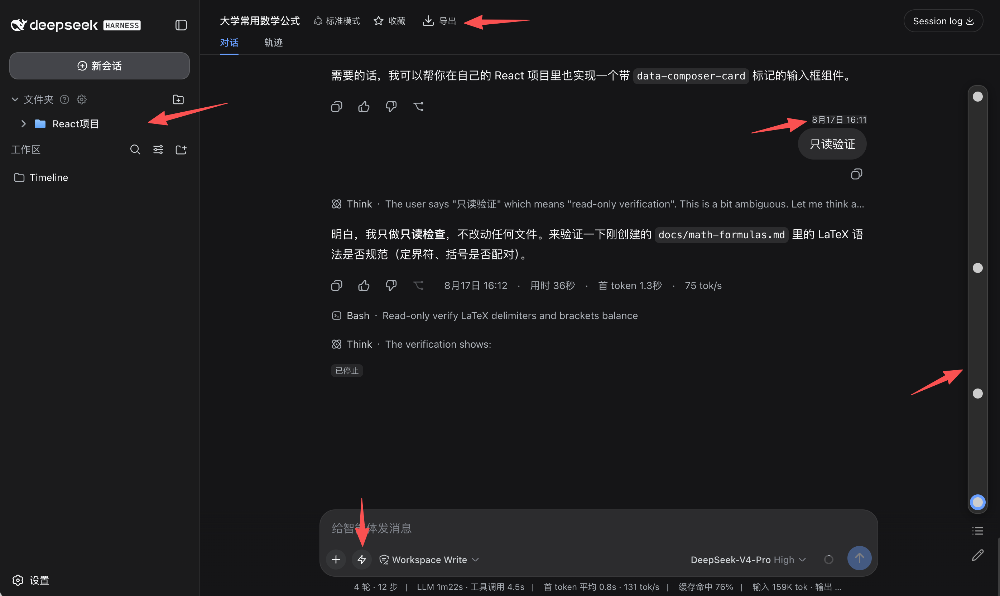

<div align="center">

# dsh-timeline

**[DeepSeek Harness](https://deepseek-harness.github.io/deepseek-harness/) 提效插件**

时间轴导航 · 收藏文件夹 · 提示词库 · 对话导出 · 公式复制 · 截图

[](https://deepseek-harness.github.io/deepseek-harness/)
[](./LICENSE)
[](https://github.com/houyanchao/dsh-timeline/pulls)
[](https://github.com/houyanchao/dsh-timeline)

**简体中文** | [English](./README.en.md)



</div>

## 📖 dsh-timeline 是什么？

dsh-timeline 是一款 [DeepSeek Harness](https://deepseek-harness.github.io/deepseek-harness/) 提效插件。

和 AI 的对话一长，翻找就成了负担：想回看某个提问要一路滚动，重要结论散落在各个会话里，公式、内容也不好带走。dsh-timeline 为此而生——它在会话右侧生成一条可视化时间轴，让你在长对话中一键跳转；并配套收藏文件夹、图钉标记、闪记、提示词库、多格式导出等能力，把"找、记、整理、带走"这一整套体验补齐。

插件深度贴合宿主界面：主题实时跟随、中英文界面、每个功能都可独立开关，装上即用，不打扰原有习惯。

## ✨ 功能特性

- 🧭 **时间轴导航** — 会话右侧轴条按提问定位，点击直达；紧凑模式、虚拟化渲染、`↑` / `↓` 键跳转
- 📌 **标记重点** — 长按时间轴节点打上图钉，重要提问一眼可见
- 📋 **问题列表** — 全部提问带序号列出，激活行随阅读位置联动
- ⭐ **收藏文件夹** — 整段对话、单条提问、闪记都能收进两级文件夹，拖拽整理、置顶、搜索
- 📝 **闪记** — 可拖拽缩放的快速笔记面板，随手记录灵感
- 💬 **提示词库** — 常用提示词存下来，在输入框旁一键调用
- ⌨️ **智能输入** — `Enter` 换行、双击 `Enter` 发送；选中文字快速追问；发送后保持阅读位置
- 📤 **对话导出** — Markdown / TXT / JSON / CSV / PNG / PDF，数学公式照常渲染
- 🧮 **公式复制** — 点击公式复制 LaTeX 或 MathML，可直接粘贴进 Word
- 📸 **消息截图** — 点击回复下方的「截图」，勾选提问或回复并选择清晰度，即可复制或下载一张 PNG。内容超出尺寸上限时会等比缩小
- 🔔 **回复提醒** — 浏览历史时回复完成，弹窗 + 可选提示音
- 💾 **数据备份** — 插件数据一键导出 / 导入（JSON）
- 🎨 **贴合宿主** — 深浅主题实时跟随，中英文界面，逐功能开关

## 📦 安装

### 安装方式 1（客户端）

在 [DeepSeek Harness](https://www.deepseek.com/harness/) 客户端打开「插件」→「添加插件」，输入包名 `dsh-timeline`，点击「安装」。


### 安装方式 2（通过命令行从 npm 安装）

```bash
# 安装 dsh-timeline 插件
dsh plugin --profile web add dsh-timeline
```

## ⭐ 支持一下

如果 dsh-timeline 好用，欢迎给个🌟，帮助更多人发现它！

## 📄 许可证

本项目基于 [GPL-3.0-or-later](./LICENSE) 协议开源。

这意味着你可以自由地使用、学习、修改和分发本项目，但基于本项目的衍生作品也必须以相同协议开源，并保留原始版权声明。商用前请确认符合协议要求。
